# TP1 Développement d'applications réparties
# Activité 1-1 : Première connexion Client/Serveur
### Objectif
Établir une communication entre un client et un serveur en Java à l'aide des sockets TCP.

### Application serveur
La classe Server attend la connexion d'un client sur le port 1234.

### Application client
La classe Client se connecte au serveur à l'aide d'une socket TCP.
### capture d'ecran :
### server:
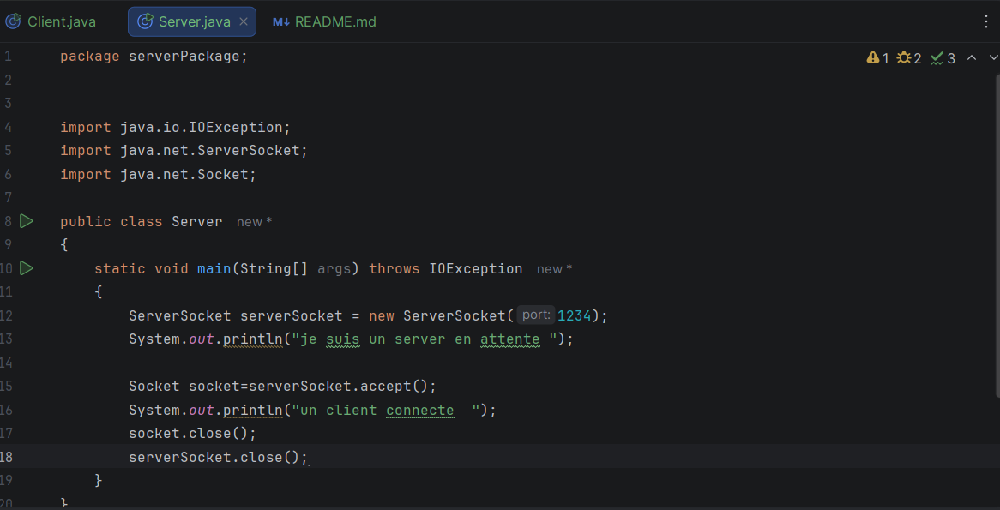
### client :
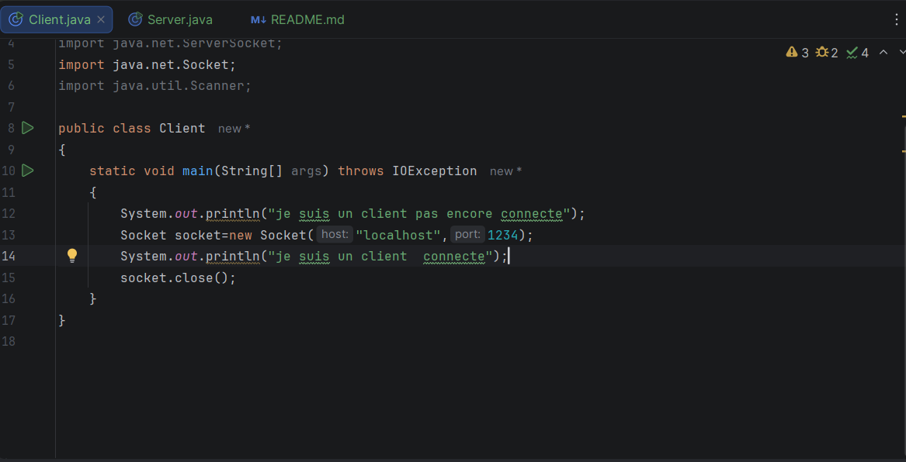
### Résultat :
### lancement du serveur :
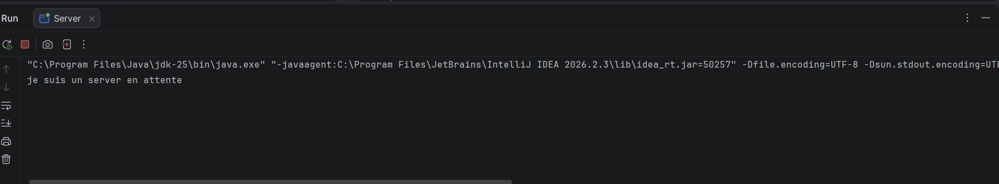
### lancement du client :
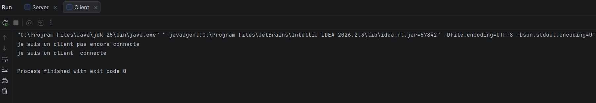
### apres lancement du client le serveur affiche ce message :
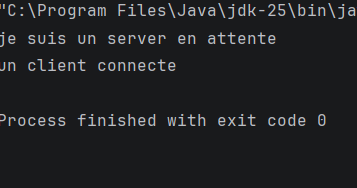

### Conclusion
Ce TP m'a permis de comprendre la communication client/serveur en Java.

# Activité 1-2 : Service de calculatrice

### Objectif

Établir une communication entre un client et un serveur en Java à l'aide des sockets TCP afin de réaliser un calcul côté serveur et de renvoyer le résultat au client.

### Application serveur

La classe `Server`, située dans le package `serverPackage`, attend la connexion d'un client sur le port 1234.

Après la connexion, le serveur reçoit un nombre entier envoyé par le client à l'aide de `DataInputStream`. Il multiplie ce nombre par 5, puis renvoie le résultat au client avec `DataOutputStream`.

### Application client

La classe `Client`, située dans le package `ClientPackage`, se connecte au serveur à l'aide d'une socket TCP sur `localhost` et le port 1234.

Le client demande à l'utilisateur de saisir un nombre entier, l'envoie au serveur, puis reçoit et affiche le résultat du calcul effectué par le serveur.

### Résultat :
### serveur:
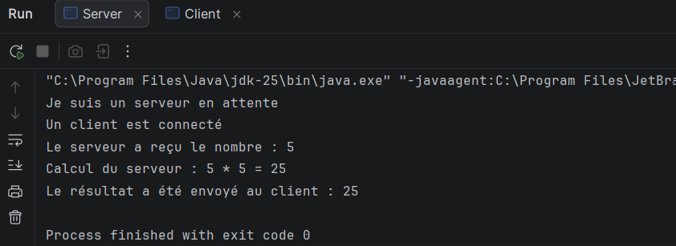
### client :
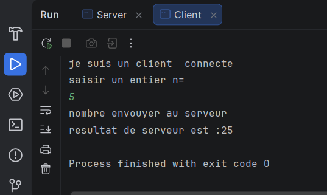


### 5-modification de code :
### résultat coté client :
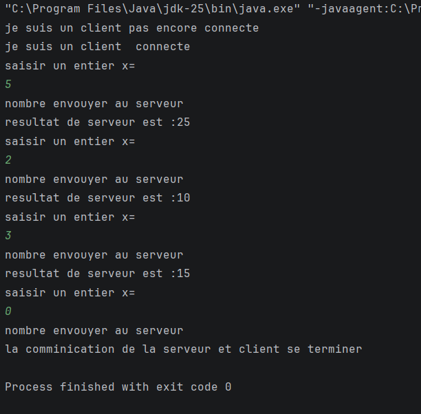
### Résultat coté serveur :
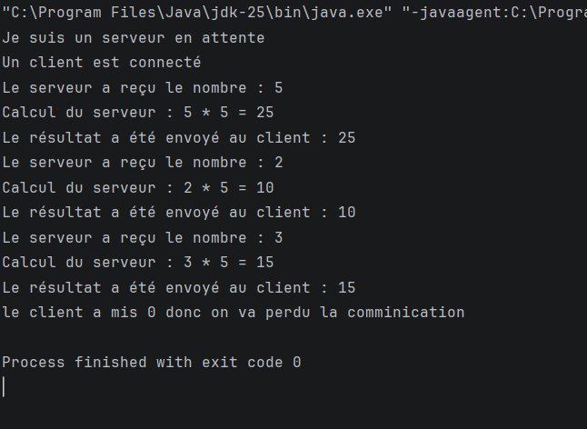
### Conclusion

Cette activité m'a permis de comprendre comment échanger des données entre un client et un serveur en Java à l'aide des sockets TCP. J'ai appris à envoyer un nombre entier du client vers le serveur, à effectuer un calcul côté serveur et à transmettre le résultat au client.

# Activité 1-3 : Amélioration du service de calculatrice

### Objectif

Améliorer l'application Client/Serveur développée lors de l'activité 1-2 en utilisant les sockets TCP en Java.

Cette activité consiste à établir une connexion entre deux machines distinctes appartenant au même réseau local et à enrichir le service de calculatrice en ajoutant quatre opérations : addition, soustraction, multiplication et division.

### Application serveur

La classe `Server`, située dans le package `serverPackage`, utilise les classes `InetAddress` et `InetSocketAddress` pour configurer l'adresse IP réelle de la machine serveur et le port 1234.

Le serveur attend la connexion d'un client à l'aide de `ServerSocket`. Après la connexion, il reçoit le choix de l'opération ainsi que les deux nombres envoyés par le client.

Il effectue le calcul demandé, puis renvoie au client un indicateur de validité et, si le calcul est valide, le résultat obtenu à l'aide de `DataOutputStream`.

### Application client

La classe `Client`, située dans le package `ClientPackage`, se connecte au serveur à l'aide d'une socket TCP en utilisant l'adresse IP de la machine serveur et le port 1234.

Le client affiche un menu permettant de choisir entre les opérations suivantes :

- 1 : Addition
- 2 : Soustraction
- 3 : Multiplication
- 4 : Division
- 0 : Quitter

Après le choix de l'opération, le client demande à l'utilisateur de saisir deux nombres, puis envoie le choix et les valeurs au serveur.

Le client reçoit ensuite le résultat du calcul effectué par le serveur et l'affiche à l'écran. En cas de division par zéro ou d'opération invalide, un message d'erreur est affiché.

### 1. Modification du code : connexion entre deux machines

Dans cette étape, `localhost` est remplacé par l'adresse IPv4 réelle de la machine serveur afin de permettre la communication entre deux ordinateurs du même réseau local.

### Configuration du serveur

```java
InetAddress ip = InetAddress.getByName("192.168.1.4");
InetSocketAddress adresse = new InetSocketAddress(ip, 1234);

ServerSocket serverSocket = new ServerSocket();
serverSocket.bind(adresse);
```

### Configuration du client

```java
Socket socket = new Socket("192.168.1.4", 1234);
```

**Remarque :** l'adresse `192.168.1.4` est un exemple. Elle doit correspondre à l'adresse IPv4 réelle de la machine serveur.


### 2. Résultat : service de calculatrice amélioré

### Résultat côté client :
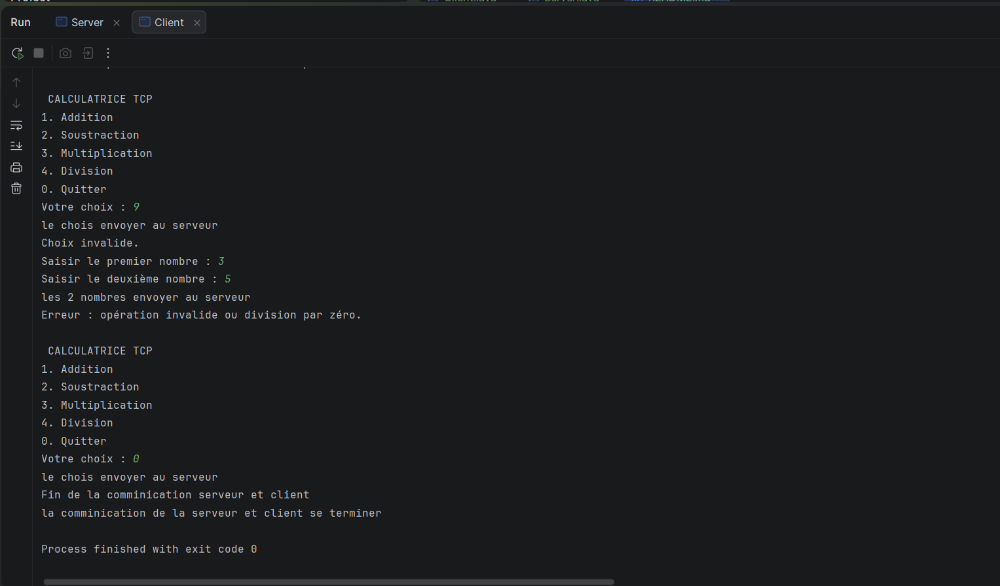


### Résultat côté serveur :
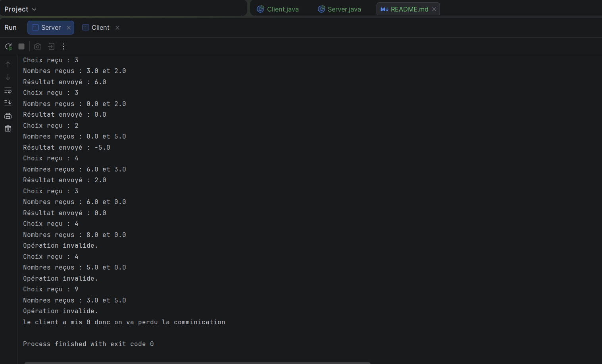
###

### Conclusion

Cette activité m'a permis d'améliorer mon application Client/Serveur en Java à l'aide des sockets TCP. J'ai appris à configurer une connexion entre deux machines différentes en utilisant `InetAddress` et `InetSocketAddress`.

J'ai également appris à enrichir un service de calculatrice en permettant au client de choisir une opération, d'envoyer les données au serveur et de recevoir le résultat du calcul effectué. Enfin, j'ai compris l'importance de respecter l'ordre d'envoi et de réception des données lors d'une communication TCP.
